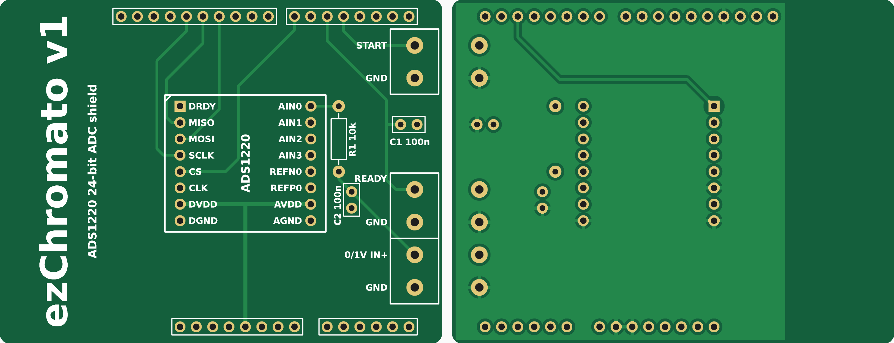

# ezChromato v1 shield

An Arduino Uno shield that replaces the breadboard wiring of ezChromato. It carries the ADS1220 24-bit ADC module, the input filter and three screw terminals for the chromatograph signals.

This folder contains everything needed to order the bare PCB from a manufacturer such as JLCPCB or PCBWay. The board uses through-hole parts only and is meant to be soldered by hand.



*Left: top side. Right: bottom side, mirrored (as seen when the board is flipped).*

## Files in this folder

| File | Description |
|---|---|
| `ezChromato_v1_gerbers.zip` | Manufacturing files, ready to upload as-is |
| `ezChromato_v1_preview.png` | Rendering of both sides of the board |
| `README.md` | This file |

## Contents of the zip

| File | Layer |
|---|---|
| `ezChromato_v1.GTL` | Top copper |
| `ezChromato_v1.GBL` | Bottom copper (ground plane) |
| `ezChromato_v1.GTS` | Top solder mask |
| `ezChromato_v1.GBS` | Bottom solder mask |
| `ezChromato_v1.GTO` | Top silkscreen |
| `ezChromato_v1.GKO` | Board outline |
| `ezChromato_v1.DRL` | Excellon drill file, all holes plated |
| `README.txt` | Short summary of the ordering parameters |

Gerber files are in RS-274X format, in millimetres.

## Ordering the PCB

Upload `ezChromato_v1_gerbers.zip` without unpacking it, then use these settings:

| Parameter | Value |
|---|---|
| Layers | 2 |
| Dimensions | 68.58 × 53.34 mm |
| Thickness | 1.6 mm |
| Copper weight | 1 oz |
| Surface finish | HASL or ENIG |
| Minimum track / clearance | 0.4 mm / 0.4 mm |
| Drill sizes | 0.9, 1.0 and 1.3 mm (60 holes) |
| Solder mask colour | Any |

Always check the manufacturer's online Gerber preview against `ezChromato_v1_preview.png` before paying.

## Parts to solder

| Reference | Part | Footprint |
|---|---|---|
| ADS1220 | CJMCU-1220 ADS1220 module | 2 × 8 pins, 2.54 mm pitch, 20.32 mm (0.8") between rows |
| R1 | 10 kΩ resistor | Axial, 10.16 mm (0.4") pitch |
| C1, C2 | 100 nF ceramic capacitor | 2.54 mm (0.1") pitch |
| START, READY, 0/1V | 2-pin screw terminal, 3 pieces | 5.08 mm pitch |
| Arduino headers | Male pin headers: 1 × 10, 2 × 8, 1 × 6 | 2.54 mm pitch |

The module can be soldered directly or plugged into two 1 × 8 female headers. Its pin names are printed on the board: DRDY goes on the square pad, next to the corner mark.

Before ordering, check that your ADS1220 module has 20.32 mm (8 breadboard holes) between its two pin rows. Other ADS1220 breakouts may use a different spacing or pin order.

## Connections

| Signal | Arduino pin | Notes |
|---|---|---|
| ADS1220 DRDY | D2 | |
| ADS1220 MISO | D12 | |
| ADS1220 MOSI | D11 | |
| ADS1220 SCLK | D13 | |
| ADS1220 CS | D7 | |
| ADS1220 DVDD, AVDD | 5V | |
| ADS1220 DGND, AGND, CLK | GND | CLK is grounded to select the internal oscillator |
| START terminal | D4 | Dry contact to GND |
| READY terminal | D5 | Dry contact to GND, with C1 (100 nF) to GND |
| 0/1V IN+ terminal | — | Through R1 (10 kΩ) to AIN0, with C2 (100 nF) across the input |

Each terminal block has its own GND screw. AIN1 to AIN3, REFP0 and REFN0 are not connected.

The screw terminals sit on the edge opposite the Arduino USB connector.

## Firmware

The shield connects DRDY to D2, so the sketch must contain:

```cpp
#define ADS1220_DRDY_PIN  2
```

## Status

The Gerber files were generated by script and verified by reading them back: every connection is continuous, there are no shorts, and clearances are at least 0.4 mm. The wiring matches the working breadboard prototype. The PCB itself has not been manufactured or tested yet.

## License

MIT, like the rest of the ezChromato project.
